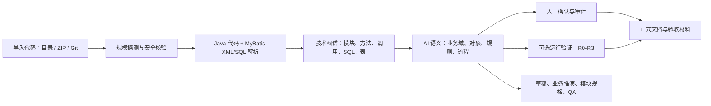

# Code2Business（C2B）—— 从遗留代码还原业务知识

> 当前正式版本：[**v0.3.1**](https://github.com/imlao17/Code2Business/releases/tag/v0.3.1)，发布日期 2026-08-13。
> 版本变化见 [CHANGELOG.md](CHANGELOG.md) 和 [v0.3.1 发布说明](docs/releases/v0.3.1.md)。本版本修复 macOS Desktop 的 SQLite 扫描启动锁与大项目扫描期间的页面可见性，不等同于多租户商业交付版。

Code2Business 把旧系统代码转换为可追溯、可确认、可交付的业务资产：

```text
代码仓库 → 技术图谱 → 业务域 / 对象 / 规则 / 流程 → 运行验证 + 人工确认 → 需求与交付文档
```

它解决的不是“让 AI 解释一段代码”，而是以下更完整的问题：

- 接手遗留系统时，不知道系统有哪些模块、入口、表和调用关系；
- 重构、替换、迁移前，缺少可追溯的业务规则、数据影响与模块职责；
- 产品、实施和客户需要业务文档，但知识只藏在代码和少数开发人员脑中；
- 希望 AI 加速理解，但不接受没有代码证据、无法人工核实的结论。

系统先用确定性扫描建立代码证据，再由 AI 做语义归纳；所有正式交付内容都以人工确认作为可信边界。

**当前定位（2026-08）**：这是一个本地单实例、单团队试点工具，不内置登录、角色权限或跨客户访问隔离。
请将 Web 默认部署在 `localhost` 或可信内网；若要开放给多人或公网，必须先由外部反向代理提供身份认证与访问边界。
已验证的第二样本、质量口径与未覆盖能力见[质量基线](docs/quality-baseline.md)和[RuoYi-Vue 验证报告](docs/validation/ruoyi-vue-2026-08.md)。
该固定提交的首轮独立语义抽样为 50 条：47 条正确、3 条部分正确，严格正确率 94%；这是本次
样本和生成批次的审计结果，不是跨项目通用准确率。

## 三个独立产品

本仓库包含 **三个可以分别安装、部署和使用的产品**。它们共享同一套 `core/` 引擎和数据模型，但不要求彼此同时存在。

| 产品 | 适合谁 | 解决的问题 | 独立运行条件 | 入口 |
|---|---|---|---|---|
| **① C2B 工作台** | 产品经理、业务分析师、测试、交付顾问 | 可视化图谱、人工确认、R0-R3 运行证据管理、单团队评审与导出 | 浏览器版用 Docker；macOS 本地版不需要 Docker | [Web 工作台](web/README.md) / [macOS Desktop](desktop/README.md) |
| **② C2B CLI** | 开发、架构、运维、CI/批处理使用者 | 在服务器或脚本中批量扫描、生成规格、导出文档、接入自动化 | Python 3.11+；可选 PostgreSQL；语义可选外部 LLM 或 Agent Native 导入 | [cli/README.md](cli/README.md) |
| **③ C2B Agent Skills** | 使用 Claude Code、Codex、opencode 等 Agent 的团队 | 用自然语言编排扫描、语义分析和文档交付，保留每阶段过程与证据 | Python 3.11+、pip、兼容的 Agent 宿主 | [skill/README.md](skill/README.md) |

`core/` 是三种产品共用的实现和运行时，不是第四个面向用户的部署产品。Web 镜像、CLI wheel、Agent Skill 与 macOS Desktop 都会携带或安装它。macOS Desktop 是产品①的本地优先分发形态，不是一套重复的业务内核。

### 如何选择

```text
需要业务人员在浏览器里看图谱、确认规则、下载文档？ → 选 Web 工作台
希望在 Mac 上双击即用、直接选择本地代码目录？      → 选 C2B Desktop
需要在服务器、终端、CI 或脚本中稳定批处理？       → 选 CLI
希望直接对 AI Agent 说“分析这个仓库并交付文档”？     → 选 Agent Skills
```

三种产品默认各自保存数据，可以独立使用；如果希望 CLI/Skill 的分析结果出现在 Web 工作台，请把它们都配置为同一个共享 PostgreSQL 地址。Web 默认内置的 PostgreSQL 容器并不对宿主机暴露端口，跨产品共用时建议使用单独托管的 PostgreSQL，或由维护者显式配置受保护的数据库网络。

## 三种产品的快速使用

### ① C2B Web 工作台：面向可视化协作与交付

**适用场景**：需要把遗留系统分析结果展示给产品、实施、业务方或客户；需要人工确认业务规则、处理待确认项并下载交付文档。

```bash
cd web/deploy
./up.sh  # 首次启动会创建私有 .env 并生成数据库密码
# 打开 http://localhost:8080
```

启动后，在网页中依次完成：

1. 上传 ZIP，或输入 Git 地址创建项目；Git 导入完成克隆后再继续；
2. 检查代码来源和项目名称，点击“开始扫描”构建确定性代码图谱；
3. 扫描完成后点击“运行标注”，生成业务域、对象、规则、流程和业务推演；
4. 在“流程与规则”页确认、修改或废弃规则；
5. 对规则、流程或业务推演录入测试、受控环境或生产环境的运行证据；
6. 在“文档与验收”页下载正式文档、草稿、Excel 或模块规格 ZIP。

Web 也支持完全离线交付：构建机执行 `./build-dist.sh`，目标机器只需 Docker 即可加载镜像包运行。离线目标机先复制 `.env.example` 为私有 `.env` 并设置密码；如果使用内网模型，需在可信网络中显式设置 `C2B_ALLOW_PRIVATE_LLM=1`。详见 [Web 工作台说明](web/README.md) 与 [离线部署说明](web/deploy/README.md)。

这里的两个分析层次需要区分：**开始扫描**结束后即可看到模块、代码对象、调用关系、数据表和 SQL 等确定性图谱；只有完成下一步的**运行标注**，业务域、业务对象、规则和流程等语义结果才会出现。Web 端没有交互式 Agent 会话，因此“运行标注”需要先配置云端模型 Provider；若不配置模型，也可以只使用扫描图谱和相关导出能力。

### ①a C2B Desktop（macOS）：面向本地、离线与即开即用

**适用场景**：不希望安装 Docker，也不想先部署服务器；在个人 Mac、客户现场或内网笔记本上直接选择一个源码目录开始业务还原。

Desktop 使用与 Web 工作台相同的 Vue 界面和 Python Core，但在本机以 `.app` 运行：默认 SQLite、本地目录选择器、
本地任务进程和 `127.0.0.1` API，不提供登录也不会开放网络端口。通过“本地代码目录”导入时只关联原目录，不复制或删除原始代码；模型 Key 保存在当前用户的 macOS 钥匙串。构建、安装、签名公证、数据位置、隐私边界和当前限制见 [C2B Desktop（macOS）说明](desktop/README.md)。

### ② C2B CLI：面向自动化、服务器和批处理

**适用场景**：希望把分析纳入 CI、夜间任务、脚本管线，或在没有浏览器界面的服务器上完成扫描与交付。

```bash
# 在源码仓库构建并安装
./cli/build-wheel.sh
python3 -m pip install cli/dist/c2b-*.whl

# 初始化数据库后先完成确定性扫描
c2b init
c2b scan /path/to/legacy-code --name legacy-system
# 方案 A：云端 Provider（配置 OpenAI Compatible 或 Anthropic Native 后运行）
c2b label 1 --limit 200

# 方案 B：当前 Agent（无需在 C2B 配置外部 Key）
c2b export-evidence 1 --output evidence.json
c2b agent-schema > semantic-result.json
# 让当前 Agent 根据源码和 evidence.json 填写 semantic-result.json
c2b import-semantic 1 --input semantic-result.json

# 模块规格仍需要云端 Provider
c2b module-specs 1
c2b docs 1 --type overview --output 系统现状说明书.md
c2b docs 1 --type rules --output 业务规则清单.md
```

CLI 的确定性扫描可独立完成。云端语义功能支持 OpenAI Compatible 与 Anthropic 原生 API；若正通过 Codex、Claude Code 等 Agent 工作，可用 Agent Native 的证据导出/结构化导入完成业务域、对象、规则和流程，不需在 C2B 中再配置外部模型 Key。模块规格和 QA 仍是独立 LLM 能力。完整命令、配置和 CI 使用方式见 [CLI 说明](cli/README.md)。

### ③ C2B Agent Skills：面向自然语言编排

**适用场景**：团队已经使用 AI 编程 Agent，希望通过一句话完成分析，又需要 Agent 在每个阶段说明覆盖范围、证据和待确认项。

```bash
cd skill
./install.sh
export PATH="$HOME/.c2b/venv/bin:$PATH"
```

随后在兼容的 Agent 中直接说：

```text
用 c2b 分析 /path/to/legacy-code，先给我规模报告，再生成业务规则和系统现状说明书。
```

技能默认让当前 Agent 通过“扫描证据 → 结构化业务结论 → 校验入库”完成语义阶段，不会要求重复配置外部模型 Key；如需无人值守批量运行，也可显式改用云端 Provider。对于中小仓库，还可使用零依赖参考版进行规模探测和辅助分析。完整安装方式、宿主要求和使用边界见 [Agent Skills 说明](skill/README.md)。

## 共同工作原理



- **代码证据优先**：每条规则和结论都尽量关联文件、行号、表或调用链；
- **AI / Agent 只做语义归纳**：云端模型或当前 Agent 的结果先进入待确认知识，而不是直接成为正式结论；
- **正式/草稿分离**：正式文档只纳入人工确认的业务知识；草稿才包含未确认 AI 项和业务主线；
- **三条信任轴不混算**：V/代码定位表示静态证据，R0-R3 表示运行验证，人工确认状态单独保存；确认或录入运行证据都不会改写 AI 可信度；
- **项目范围**：项目、扫描、规则、问答、模块规格和确认记录按项目关联保存；这不是访问控制或多租户隔离；
- **可追溯**：规则确认、修改、废弃都会留下审计记录。

## 仓库结构

```text
├── core/              # 共享 Python 引擎：扫描、图谱、语义、API、文档
├── web/               # 产品①：Vue 工作台与 Docker/离线部署
├── cli/               # 产品②：CLI wheel 与构建脚本
├── skill/             # 产品③：Agent Skills 与安装脚本
├── docs/              # PRD、架构、路线图
└── core/tests/        # 回归测试
```

## 开发与验证

GitHub Actions 会在每个 PR 和 `main` 提交上自动执行后端回归、前端生产构建、wheel/文档检查，
以及真实 Docker Compose + PostgreSQL 的导入、扫描、API 重启持久化和删除冒烟测试。本地可复跑：

```bash
# 后端回归测试
PYTHONPATH=core/src python -m unittest discover -s core/tests -v

# 前端生产构建
cd web/frontend && pnpm install --frozen-lockfile && pnpm build

# 固定 Spring/MyBatis 样本的确定性图谱回归（先按质量基线准备 project_id）
PYTHONPATH=core/src python -m c2b.cli evaluate <project-id> \
  --manifest docs/quality-fixtures/ruoyi-vue-2026-08.json

# 构建统一 wheel（同步到 CLI、Skill 与 Web 部署目录）
cd ../.. && ./cli/build-wheel.sh --copy-to web/deploy/dist
```

更多设计细节见：[产品需求文档](docs/PRD.md)、[技术架构](docs/architecture.md)、[三产品整体设计 HTML](docs/Code2Business_三产品整体设计方案_2026-08-08.html)、[运行证据设计](docs/runtime-evidence.md)、[质量基线](docs/quality-baseline.md)、[RuoYi-Vue 验证报告](docs/validation/ruoyi-vue-2026-08.md)、[实施路线图](docs/roadmap.md)。

## 安全与使用边界

- 不要提交真实客户代码、数据库、LLM Key、运行时缓存或部署环境文件；这些均已列入 `.gitignore`；
- Web 默认绑定本机地址。远程访问请放在 HTTPS、身份认证和反向代理之后；
- Git/LLM 地址默认只允许公网 HTTPS。连接内网 Git 或本地 LLM 时需要显式放宽安全开关，且只应在可信网络中使用；
- 当前深度代码图谱以 Java 为主；其他语言可被探测，但尚未具备同等级语义解析能力。
- Spring MVC 路径与 MyBatis XML/SQL 已有固定样本回归；当前可手工记录 R1 测试、R2 受控/预发布、R3 生产运行证据，但不会自动采集 OpenTelemetry、日志或 Trace。Mapper XML 与 Java Mapper 方法的精确绑定、Vue→API 映射和自动运行链路采集仍未实现。

## License

许可证待项目维护者最终确定后补充。
